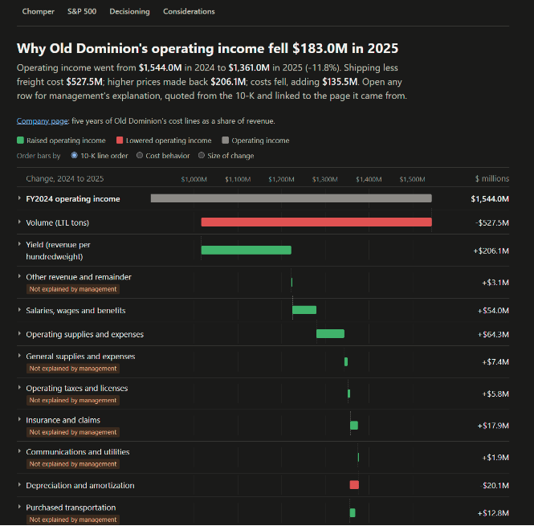

# chomper

Who holds up when revenue falls?

Chomper reads S&P 500 10-Ks to show what a company's costs did when its
revenue fell. Eleven companies so far, every number traced to the filing.

Live: https://jamesishere.github.io/chomper/

## What is on the site

- The front page lists the S&P 500 by sector and sub-industry and says, for
  every company, whether its filings can be read yet and why not when they
  cannot.
- A company page (eleven so far) shows revenue, pre-tax income and margin
  by year since 2007, with recessions shaded and acquisitions and accounting
  changes marked, then five years of the income statement line by line as a
  share of revenue.
- Old Dominion Freight Line's one-year bridge walks operating income from
  fiscal 2024 to 2025. Each bar opens to management's explanation, quoted
  verbatim from the 10-K and linked to the sentence it came from. Where the
  10-K does not account for a change, the bar says so.
- The S&P 500 page adds the index up: revenue and costs for the members as they
  were each year against today's members traced back, with a page of who was a
  member each month.
- Decisioning records every decision behind the numbers, with dates.
  Considerations records what is unsure or unfinished, and what would make it
  due.

## How it was built

Every number comes from the SEC. The scripts read each 10-K's own XBRL, keep
the filing's labels and line order, and stop unless every year foots to the
pre-tax income the company reported. Where the SEC's structured data does not
reach (the earliest years for some companies, a few acquisitions), a figure is
read by hand from the filing, with the sentence it came from quoted beside it.
A disagreement between two sources is recorded as a disagreement, never
averaged away.

The words on the bridge page were drafted by a language model, run from the
command line on a subscription rather than an API, from the filing's MD&A and
the computed bars. Code then checks every quote verbatim against the filing
and every number in the draft against the bridge, and I review and approve the
result before the page is built. The page build never calls a model, and the
"not explained by management" flags come from arithmetic, not from the model.

To rebuild every page from the committed data, with no network and no model:

    python rebuild.py

The reading scripts (`pull.py`, `history.py`, `headline.py`, `universe.py`,
`aggregate.py`, `membership.py`) fetch from the SEC and Wikipedia and need a
`.env` file with `SEC_USER_AGENT="Your Name you@example.com"`, which the SEC
requires.

## Status

Version 1, November 2026: one bridge, eleven company pages, the index pages.
Four company pages stop at fiscal 2016 and say so. Next is a cost measure for
every company, how far costs fall when revenue falls, and the working sample to
test it on. The open items are on the Considerations page; parked ideas are in
`ideas.md`.
